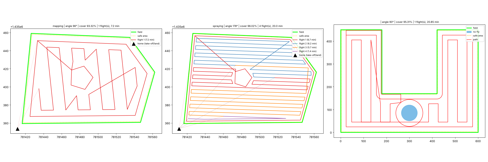

# 🚁 Drone Flight Plan — AI drone mission planner for farm fields

Give it a field (a satellite/drone image or an outline). It **finds the field with AI**, puts it on the map
with GPS, and plans a **drone mission for mapping or spraying**:

- take-off and landing at a home point **outside the field**
- **terrain following** on slopes and terraces
- avoids trees, poles and wells you mark as no-fly zones
- splits the job into flights based on **battery and tank size**
- exports files for QGroundControl and Google Earth

Built for small, irregular fields (India-first profiles).



## Quick start

```bash
pip install torch --index-url https://download.pytorch.org/whl/cpu   # or the CUDA build
pip install -e ".[all]"
streamlit run app/streamlit_app.py          # web app
drone-flight-plan --help                              # command line
```

Docker: `docker build -t drone-flight-plan . && docker run -p 8501:8501 drone-flight-plan`

## The app: 4 steps

1. **Get the field**, one of these:
   - 🛰️ **Pick on map**: draw a box, and the app downloads the imagery with GPS already attached
   - 📸 **Screenshot** from Google Maps/Earth plus the GPS of two corners (or 3+ known points)
   - 🗺️ **GeoTIFF**: a drone orthomosaic (WebODM) or any georeferenced image
   - ✏️ **Draw / KML**: outline the field yourself, or correct the AI's outline

   The AI then outlines every field. **Click yours.**
2. **Home point + no-fly zones**: click where to take off and land; draw over trees, poles and wells.
3. **Plan**: coverage %, number of flights, minutes, litres and refills, plus warnings.
4. **Download**: one QGroundControl `.plan` per flight, KML, GeoJSON, CSV, and a summary.

## Command line

```bash
drone-flight-plan plan examples/sample_field.kml -p india_spraying --home 12.97095,77.59395 --dem copernicus -o out/
drone-flight-plan georef screenshot.png --tl 12.9720,77.5938 --br 12.9705,77.5956 -o shot.tif
drone-flight-plan fetch-imagery --bbox 77.5938,12.9705,77.5956,12.9720 -o area.tif
drone-flight-plan segment area.tif --checkpoint models/unet_resnet34_3class.pt -o fields.geojson
drone-flight-plan train --profile default            # downloads AI4Boundaries, trains, auto-resumes
drone-flight-plan evaluate --checkpoint models/unet_resnet34_3class.pt
```

Training on Colab: `notebooks/train_on_colab.ipynb` (T4 GPU, about 10 cells, everything saved to Drive).

## Configuration

All settings are in YAML profiles (`src/drone_flight_plan/configs/`) and checked by pydantic:

| Profile | Use |
|---|---|
| `default` | mapping at 40 m, generic quad |
| `india_mapping` | small fields: 30 m height, 70 % overlap (good WebODM orthomosaics), 1 m edge gap |
| `india_spraying` | example ~10 L sprayer: 2.5 m above crop, 4.5 m swath, tank / dose / battery / pump channel |

Key derived values:
- stripe spacing = footprint × (1 − overlap), where footprint = camera width (mapping) or spray width (spraying)
- pump flow (L/s) = dose (L/ha) × spacing (m) × speed (m/s) / 10 000
- drone width only sets the safety gap around no-fly zones (½ span + clearance)

⚠️ The spraying values are **examples**. Use your drone's datasheet and the product label dose.

## How it works

```
image ──► U-Net / DeepLabV3+ (3 classes: field / boundary / background)
      ──► watershed on the boundary class → one polygon per field (touching fields stay separate)
      ──► georeferenced polygon → local UTM metres
      ──► coverage planner
            • stripes at the best angle: never leave the safe area → max coverage → min time
              (distance + turns + climbing); near-ties go to field-edge or hill-contour angles
            • headland lap(s) around the edge and around obstacles
            • boustrophedon cell decomposition for L/U shapes and obstacles
            • moves between stripes stay inside the field (edge-walk / visibility graph)
      ──► mission builder
            • home → travel height → work height → stripes → travel height → home → land
            • terrain following from a DEM (Copernicus 30 m or your own DSM)
            • split into flights by battery (with reserve) and tank (spraying), resuming exactly where it stopped
            • pump on/off (DO_SET_SERVO) only on spray passes
            • safety checks: legal ceiling, home inside field, overflown land, drift height
      ──► exporters: QGroundControl .plan · KML · GeoJSON · CSV
```

Coverage is honest: it counts only work passes flown with the requested overlap, not transit moves.

## Metrics

| Stage | Metrics |
|---|---|
| Segmentation | IoU / Dice / precision / recall per class, field-extent IoU, boundary F1 @ 2 px |
| Field separation | instance precision / recall / F1 (IoU ≥ 0.5), mean matched IoU; thresholds tuned on validation |
| Planning | coverage %, missed m², spill m², metres outside the safe area, distance, turns, climb, minutes |
| End-to-end | plan on the AI polygon, then score against the real field; extra-safety-margin trade-off study |

## Data and India notes

- **Pre-training:** AI4Boundaries (EU, 1 m orthophotos, open data, JRC).
- **India:** Indian fields are small and separated by bunds, so 10 m Sentinel-2 imagery is too coarse. The plan:
  1. Fly your own mapping missions and build orthomosaics in WebODM.
  2. Label 100–200 tiles (QGIS/CVAT); `meta_from_folder()` builds the training table.
  3. Fine-tune with `train.init_checkpoint`. See the notebook's section 6.
- Public field outlines for India exist (Wang, Waldner & Lobell 2022, 10k polygons, CC-BY-4.0), but the imagery they were drawn on is commercial.
- **Basemap imagery** (Esri / Google / Apple) is for personal testing only. Use your own or licensed imagery in production.

## Safety and regulations

The planner does **not** know about wires, trees or buildings unless you mark them.
Always review the route before flying. In India, follow the DGCA Drone Rules:
- register the drone on Digital Sky
- hold a Remote Pilot Certificate
- check the airspace zone (green zones allow up to 400 ft / 120 m, which is the default `max_agl_m`)
- for spraying, use approved chemicals and doses

## Project layout

```
src/drone_flight_plan/
  config.py            settings (pydantic) + YAML profiles in configs/
  geo/                 CRS, GeoTIFF/KML IO, map tiles, screenshot georeferencing, DEM/terrain
  segmentation/        data, model, train, tiled inference, post-processing, metrics
  planning/            geometry, coverage (stripes, cells, angle search), mission (flights, heights, safety)
  export/              QGroundControl, KML, GeoJSON, CSV, zip
  evaluation/          end-to-end scoring
  pipeline.py          high-level API used by app + CLI
  cli.py               `drone-flight-plan` (or `dfp`) command
app/streamlit_app.py   web app
notebooks/             Colab training
tests/                 pytest (planner, mission, geo, exports, segmentation, app)
```

## Roadmap

- DJI WPML/KMZ export (once the drone is chosen)
- SAM click-to-outline fallback in the app
- Multi-field missions for neighbouring plots of one farmer
- Wind-aware stripe direction for spraying drift

MIT licence.
